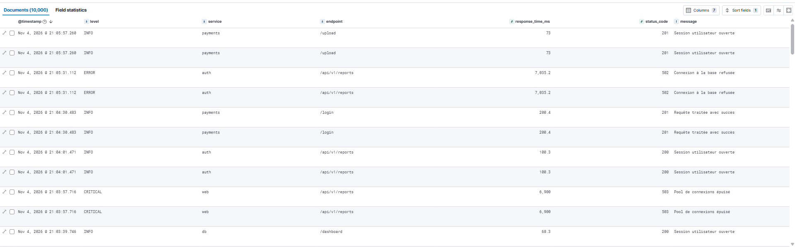

# LogMonitor SaaS

Plateforme de monitoring et d'analyse de logs (scénario D : application web SaaS), basée sur la stack ELK, MongoDB, Redis et Flask, déployée avec Docker Compose.

## Prérequis

- Docker Desktop (moteur WSL 2 activé)
- Git
- Python 3.11 (pour le script de génération de données)

## Démarrage

```bash
cp .env.example .env
# modifier MONGO_PASSWORD et FLASK_SECRET_KEY dans .env
docker compose up -d --build
```

Temps de démarrage : 5 à 10 minutes la première fois (téléchargement des images), moins de 2 minutes ensuite.

## Vérification

| Service | URL |
|---|---|
| Elasticsearch | http://localhost:9200 |
| Kibana | http://localhost:5601 |
| Webapp | http://localhost:8000 |

```bash
docker compose ps
```

Les services elasticsearch, kibana, logstash, mongodb, redis et webapp doivent être `healthy`.

## Données de test

```bash
python3 -m venv venv
source venv/bin/activate
pip install faker
python scripts/generate_logs.py --rows 5000 --file-id f0001
```

Le script crée un fichier CSV et un fichier JSON dans `data/logs/`, lus automatiquement par Logstash (environ 10 000 documents indexés). Pour régénérer des données, utilisez un nouvel identifiant (`--file-id f0002`).

Vérification : `curl "http://localhost:9200/logs-saas-*/_count?pretty"`

## Résultat dans Kibana

Data view `logs-saas-*`, champ de temps `@timestamp` :



## Arrêt

```bash
docker compose down
```